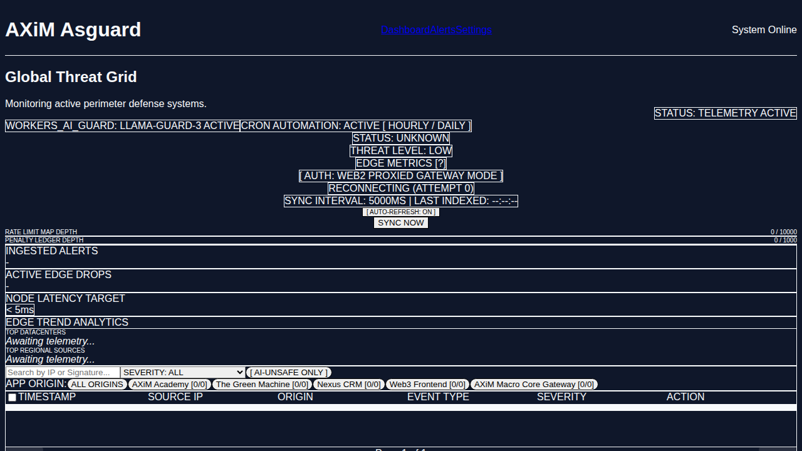

# AXiM Asguard — SOC & Web Application Firewall

Asguard is the AXiM ecosystem's security perimeter and security operations console. It runs as two
Cloudflare Workers that work as one system: a fail-closed edge interceptor that inspects and drops
hostile traffic before it reaches an origin, and a Next.js SOC cockpit where operators watch the
telemetry, triage threats and manage the global blocklist.

```
                       ┌──────────────────────────────────────────────┐
   inbound traffic ──► │  asguard-interceptor  (Cloudflare Worker)    │
                       │  · blocklist interlock (KV, fail-closed)      │
                       │  · threat engine (CGI/traversal/SQLi/XSS/RCE) │
                       │  · rate limiting + penalty escalation         │
                       │  · AI classifier (8s budget, deterministic    │
                       │    fallback)                                  │
                       └───────┬───────────────────────┬──────────────┘
                      403 / 429│                       │ ctx.waitUntil()
                               ▼                       ▼
                        blocked request      ┌──────────────────────┐
                                             │  telemetry pipeline  │
                                             │  KV buffer → Supabase│
                                             │  → COCKPIT_INGEST_URL│
                                             └──────────┬───────────┘
                                                        ▼
                       ┌──────────────────────────────────────────────┐
                       │  soc-cockpit  (Next.js 15 / OpenNext)        │
                       │  · LiveThreatFeed  (realtime, backoff,       │
                       │    latency badges)                            │
                       │  · SSE ingest stream (15s keep-alive)         │
                       │  · blocklist / audit / analysis proxy         │
                       └──────────────────────────────────────────────┘
```

## Components

### `asguard-interceptor/` — edge WAF (Cloudflare Worker)

Stateless request inspection that runs before any application logic.

| Concern | Implementation | Behaviour |
| --- | --- | --- |
| Global blocklist interlock | `src/index.ts` | `cf-connecting-ip` is checked against `THREAT_CACHE` and `ASGUARD_BLACKLIST` **before** routing. Hit → `403`. |
| Threat engine | `src/threatEngine.ts` | Detects CGI argument injection (CVE-2024-4577 family), path traversal, PHP shell probes, SQLi, XSS, RCE, SSRF, prompt injection. CRITICAL → `403`. |
| Rate limiting | `src/index.ts` | 10 requests / 10s per IP, with escalating `penaltyLedger` that promotes repeat offenders to the durable blocklist. |
| AI classification | `src/aiService.ts` | DeepSeek primary, Anthropic failover, both under an **8-second hard deadline**. Failure returns a deterministic `risk: medium` payload rather than hanging. |
| Telemetry | `src/telemetry.ts` | Every dispatch is non-blocking via `ctx.waitUntil()`. Failed writes buffer to KV and are flushed by the cron trigger. |
| Admin surface | `src/index.ts` | `/blocklist`, `/audit`, `/telemetry`, `/analysis` require `X-Asguard-Auth` or `X-Asguard-Service-Token` (constant-time compare). |

**Fail-closed contract:** a confirmed CRITICAL threat is always `403`, never a pass-through. A
degraded AI classifier is *not* a confirmed threat — it returns a deterministic payload so the
request can still be judged by the rule engine.

### `soc-cockpit/` — SOC console (Next.js 15, OpenNext on Cloudflare)

| Route | Purpose |
| --- | --- |
| `/` | Cockpit dashboard (metric cards, live feed, blocklist, audit trail). |
| `/stream` | Global threat map and operator chat. |
| `/submit` | Submission pipeline view. |
| `/api/ingest` | Signed telemetry ingest (Zod-validated, constant-time bearer compare). |
| `/api/ingest/stream` | SSE fan-out. 15s `: keep-alive` heartbeats, abort-aware teardown, SSRF-guarded upstream proxy. |
| `/api/v1/threats/stream` | Realtime threat SSE channel backed by Supabase. |
| `/api/asguard/[...path]` | Authenticated proxy to the interceptor (`blocklist`, `audit`, `telemetry`, `analysis`). |
| `/api/health`, `/api/ready` | Liveness and readiness probes. |

`LiveThreatFeed.tsx` maintains the realtime subscription with exponential backoff (1s → 30s),
surfaces a green/amber/red latency badge, and null-coalesces every field it renders so a partial
payload can never crash the dashboard.

### `supabase/`

`migrations/20261005000000_asguard_core_schema.sql` defines `threat_events` plus the supporting
indices. `seed.sql` provides local development data.

## Environment variables

### Interceptor (`asguard-interceptor/wrangler.toml` + secrets)

| Variable | Required | Purpose |
| --- | --- | --- |
| `ASGUARD_API_KEY` | yes | Admin auth for `/blocklist`, `/audit`, `/telemetry`, `/analysis`. |
| `ASGUARD_SERVICE_TOKEN` | yes | Service-to-service auth from the cockpit. |
| `TELEMETRY_INGEST_KEY` | yes | Auth for `POST /telemetry` and `/telemetry/client-error`. |
| `SUPABASE_URL` | yes | Postgres REST endpoint for `threat_events`. |
| `AXIM_SERVICE_ROLE_KEY` | yes | Service role key for the telemetry writes. |
| `COCKPIT_INGEST_URL` | yes | Cockpit ingest endpoint for edge telemetry. |
| `DEEPSEEK_API_KEY` | no | Primary AI classifier. |
| `DEEPSEEK_BASE_URL`, `DEEPSEEK_MODEL` | no | Override the classifier endpoint/model. |
| `ANTHROPIC_API_KEY` | no | AI classifier failover. |
| `AXIM_CORE_INGEST_URL`, `AXIM_CORE_INGEST_KEY` | no | Secondary central telemetry sink. |

KV bindings: `ASGUARD_BLACKLIST` (durable blocks), `ASGUARD_TELEMETRY` (recent events + audit),
`THREAT_CACHE` (short-lived auto-blocks), `ASGUARD_KV_BUFFER` / `TELEMETRY_FALLBACK_QUEUE`
(failed-write buffer).

### Cockpit (`soc-cockpit/wrangler.toml`)

| Variable | Required | Purpose |
| --- | --- | --- |
| `SUPABASE_URL`, `SUPABASE_SERVICE_ROLE_KEY` | yes | Server-side writes and reads. |
| `NEXT_PUBLIC_SUPABASE_URL`, `NEXT_PUBLIC_SUPABASE_ANON_KEY` | yes | Realtime subscription in the browser. |
| `ASGUARD_API_KEY` | yes | Bearer token for `/api/ingest`. |
| `ASGUARD_INTERCEPTOR_URL` / `NEXT_PUBLIC_INTERCEPTOR_URL` | yes | Proxy target when the `ASGUARD` service binding is absent. |
| `ASGUARD_JWT_SECRET` | yes | Verifies operator admin claims. |
| `COCKPIT_INGEST_URL` | yes | Ingest endpoint advertised to the interceptor. |
| `NEXT_PUBLIC_DEMO_MODE` | no | `true` swaps the live feed for synthetic data. |

Set real secrets with `wrangler secret put <NAME>`; never commit them. `.env.example` documents the
local-development shape.

## Local development

```bash
# Interceptor
cd asguard-interceptor
npm install
npm test                       # vitest
npx wrangler dev               # local edge runtime

# Cockpit
cd soc-cockpit
npm install
npm run lint
npm run build
npm run dev                    # http://localhost:3000
```

## Verification and deployment

```bash
# Interceptor: unit + integration suite, then a binding-validated build
cd asguard-interceptor
npm test
npx wrangler deploy --dry-run

# Cockpit: lint, Next.js build, then the OpenNext bundle + dry-run
cd soc-cockpit
npm run lint
npm run build
npx opennextjs-cloudflare build
npx wrangler deploy --dry-run

# Deploy (requires CLOUDFLARE_API_TOKEN and the account id)
cd asguard-interceptor && npx wrangler deploy
cd soc-cockpit      && npm run deploy
```

Deploy the interceptor first: the cockpit's `services` binding resolves `asguard-interceptor` by
name.

CI runs the same battery on every push and pull request — see `.github/workflows/ci.yml`.

## Operating notes

- **Everything is fail-closed at the perimeter.** If `ASGUARD_BLACKLIST` is unreachable the request
  is not silently allowed; KV read failures surface as an error rather than an open gate.
- **Telemetry never blocks a response.** Every write is wrapped in `ctx.waitUntil()`; the caller
  returns before the Supabase round-trip completes.
- **AI is advisory, never load-bearing.** The 8-second deadline guarantees a bounded response even
  when both providers are down.
- **Rotating a shared key** (`ASGUARD_API_KEY`, `ASGUARD_SERVICE_TOKEN`, `TELEMETRY_INGEST_KEY`)
  requires updating both Workers in the same window — the cockpit's event ingest will start
  returning `401` the moment the interceptor's key changes.

## Architecture assets



## Repository layout

```
asguard-interceptor/     Edge WAF worker (TypeScript, Vitest)
  src/index.ts             request pipeline, blocklist, rate limiting, admin routes
  src/threatEngine.ts      signature engine + deterministic fallback classifier
  src/aiService.ts         AI client with 8s deadline + failover
  src/telemetry.ts         non-blocking telemetry dispatch, KV buffering, Supabase writes
  tests/                   interceptor.test.ts, hardening.test.ts
soc-cockpit/             Next.js 15 SOC console (OpenNext → Cloudflare)
supabase/                schema migrations and seed data
docs/                    architecture assets
```

## Related documents

- `plan.md` — current sprint priorities and open follow-ups
- `AGENTS_VERIFICATION.md` — verification appendix for the most recent change set
- `CHANGELOG.md` — release history
- `PROGRESS_LOG.txt` — running engineering log
- `DEBUGGING_NOTES.md` — known issues and their root causes
